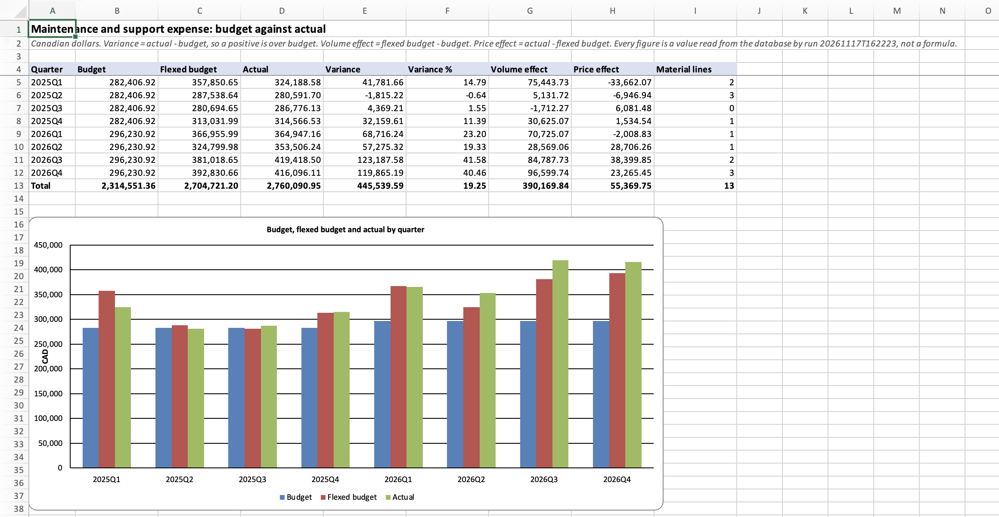

# Finance Variance Analysis Engine


A small pipeline in Python and SQL that takes two finance extracts, budget and
actual maintenance and support expense, and turns them into a variance report
in Excel with one command.

Every handoff on the way is reconciled. The file is tied to the database, the
database to the analysis, and the analysis to the workbook, so each figure in
the report can be traced back to the extract it came from.



## What it does

```
budget.csv ──┐
             ├──► raw tables ──► curated tables ──► saved queries ──► variance_report.xlsx
actual.csv ──┘
          C1, R1    C2 to C5           R2                 R3                  R4
```

| Step | What happens | Where |
|---|---|---|
| Load | Each extract is checked for its columns (C1), loaded exactly as it arrived with every value kept as text, and tied back to the file by row count and total (R1). | `src/ingest.py`, `src/load.py` |
| Validate | Four data-quality controls run in SQL: duplicates (C2), completeness (C3), mapping (C4) and reasonability (C5). | `src/controls.py`, `sql/10_*` |
| Transform | The raw text is rebuilt into four typed tables: one expense table and three description tables. The build is all or nothing, and is tied back to raw (R2). | `src/curate.py`, `sql/20` to `sql/24` |
| Analyze | Three saved queries (SQL views): budget against actual by asset, each variance split into volume and price, and totals by asset class with the material lines flagged. Tied back to the expense table (R3). | `src/analyze.py`, `sql/30` to `sql/33` |
| Report | An Excel workbook with five sheets and a chart. The saved file is opened again and tied back to the database (R4). | `src/report.py` |

Two rules run through all of it:

- **SQL computes, Python transports.** Every figure in the workbook is a value
  read from the database. Nothing is recalculated in Python and nothing is an
  Excel formula.
- **Any control that fails stops the run.** The failure is written to the
  control log first, with one line in the exceptions table for each item it
  objected to.

## Run it

Written and tested on Python 3.13.

```bash
git clone https://github.com/evelnali/finance-variance-analysis-engine.git
cd finance-variance-analysis-engine
python3 -m venv .venv
source .venv/bin/activate            # on Windows: .venv\Scripts\activate
pip install -r requirements.txt
python -m src.run
```

The run loads all eight quarters and ends like this:

```
R2 fact_expense: PASS -- 16 lines compared, 0 differ - raw 512 rows / 5,074,642.31 vs curated 512 rows / 5,074,642.31
R3 saved queries: PASS - 9 checks, 0 differ - budget 2,314,551.36, actual 2,760,090.95, variance 445,539.59
R4 report: PASS - 13 checks, 0 differ - 504 lines read back from the workbook
Pipeline finished. Every control passed. Workbook: .../data/output/variance_report.xlsx
```

The workbook is `data/output/variance_report.xlsx`. To run the tests:

```bash
python -m pytest                     # 53 passed
```

The database and the workbook are generated, so they are not in the
repository. The two extracts in `data/raw/` are in the repository, so that a
clone can run straight away. They are synthetic, and
`python -m src.generate_data` rebuilds the same two files from a fixed seed.

## The data

A small aluminium window manufacturer, one location: 12 machines and 4 software
products, 8 quarters (2025Q1 to 2026Q4), two kinds of cost per asset. That is
256 rows in each extract.

The budget comes from a driver model with written assumptions
(`config/assumptions.yml`, `src/model.py`). The actual is the budget plus
random noise plus five problems planted on purpose (`config/producer.yml`).
The analysis side never reads that second file, so the report has to find what
it can from the figures alone.

## The workbook

| Sheet | Lines | What it shows |
|---|---|---|
| Summary | 8 quarters and a total | Budget, flexed budget, actual, variance, and the variance split into volume and price. One chart. |
| Material | 13 | The asset class lines over both materiality thresholds. |
| By class | 128 | Every asset class, cost type and quarter. Material lines are shaded. |
| By asset | 256 | Every asset, cost type and quarter. The detail behind "By class". |
| Controls | the control log | Every control that has run, with PASS or FAIL and the figures it tied. |

### How a variance is split

The flexed budget is the budget for the work that was actually done, at the
planned price. It sits between budget and actual and changes one thing at a time:

```
Budget          =  budget quantity  x  budget price
Flexed budget   =  actual quantity  x  budget price      only the quantity changed
Actual          =  actual quantity  x  actual price      only the price changed

volume effect   =  flexed budget - budget
price effect    =  actual - flexed budget
variance        =  actual - budget                       the two added together
```

A positive figure is over budget. In the chart, the step from the first column
to the second is volume and the step from the second to the third is price.

### What is material

A line is material when it breaches both a dollar limit and a percent limit.
The limits are set per family in `config/settings.yml`: 25,000 and 5% for
machinery, 3,000 and 5% for software. They are tested at one level: asset
class, cost type and quarter.

## What the report shows

| Figure, all eight quarters | Amount |
|---|---|
| Budget | 2,314,551.36 |
| Actual | 2,760,090.95 |
| Variance | 445,539.59 |
| of which volume | 390,169.84 |
| of which price | 55,369.75 |
| Material lines | 13 of 128 |

Set against the five planted problems, the result is mixed, and that is the
useful part:

| Planted problem | What the report shows |
|---|---|
| Copy routers breaking down more often, all of 2026 | Flagged for the router class in 2026Q2, Q3 and Q4 (72,475, 81,880 and 58,830 over). 2026Q1 is 46% over but under the dollar limit, so it is not flagged. |
| One saw failing well beyond its age, from 2025Q3 | Not isolated. The saw class is flagged in five quarters, two of them before the fault begins. The saw itself stands out only on the By asset sheet, at 77,104 over in 2026Q4. |
| Contractor rates up 12% from 2026Q2 | Visible as a price effect on corrective maintenance: under 5,000 in the three quarters before, then 29,770, 38,883 and 22,270. |
| Half the scheduled servicing skipped in 2025Q4 | Visible, not flagged. Preventive maintenance is 30,624 under, almost all of it volume, but spread over four classes and the largest is 11,317 under. |
| The breakdowns that followed the skipped servicing | Not looked for separately. They are part of the corrective maintenance volume in 2026Q1 and Q2. |

What this shows: **a threshold belongs to the level it is tested at.** The
same limits catch three routers together and miss one saw alone. And a flag
means "worth a look", not "something is wrong": 2025Q1 has two flagged lines
and nothing planted in it.

## The controls

| Control | What it checks | Written in |
|---|---|---|
| C1 Schema conformance | The file is there, has the expected columns, and has rows. | Python |
| C2 Duplicate key detection | One row per quarter, asset and cost type. | SQL |
| C3 Completeness | Every asset in the register appears, with every cost type its family can have. | SQL |
| C4 Mapping coverage | Every row refers to an asset in the register, with a cost type its family can have. | SQL |
| C5 Reasonability | Quantity and amount agree about whether anything happened, and neither is negative. | SQL |
| R1 File to raw | Row count and total in the table equal the file. | Python |
| R2 Raw to curated | Row counts and totals by quarter and scenario equal the raw tables. | SQL |
| R3 Curated to analysis | Nine checks: the saved queries hold the same totals and lines as the expense table, and volume plus price equals the variance on every line. | SQL |
| R4 Analysis to report | Thirteen checks: the saved workbook, read back from disk, holds the same totals and lines as the database. A workbook that fails is deleted. | Python |

A control is written in the place where both sides of its comparison can be
seen. Two sides inside the database: SQL. One side outside it, a file or a
workbook: Python.

Results go to the `control_results` table and exceptions to the `exceptions`
table. Both are kept across runs.

## Where things are

```
config/      settings, assumptions, asset register, the generator's private settings
data/raw/    the two extracts
data/output/ the workbook (generated, not in the repository)
docs/        data_dictionary.md: every table, saved query and column
sql/         table layouts, controls, build files and saved queries, numbered in run order
src/         the Python: one file per pipeline step, and run.py to run them all
tests/       53 tests
```

## Tests and CI

The tests build a small in-memory database from the real schema and SQL files,
change one thing, and check a figure that can be worked out by hand. Each
control has been watched failing as well as passing.

On every push, GitHub Actions installs the project from nothing on a clean
machine, runs the tests, and then runs the whole pipeline from the extracts
(`.github/workflows/ci.yml`).

## Known gaps

- **A word where a number should be becomes 0.** A blank quantity or amount
  stops the build. Text such as `n/a` does not, and there is no check for it yet.
- **A line with no budget cannot be flagged**, because its percent cannot be
  worked out.
- **Materiality is tested at one level only.** A variance that is large for a
  single asset, or for one cost type across the whole plant, is not flagged
  unless it is also large for its asset class.
- **The control log keeps every run**, so the Controls sheet grows each time
  the pipeline runs on the same database.
- **Variance is split into volume and price only.** Mix is not separated. A
  test for a variance that keeps the same direction over several quarters was
  designed and not built.
- **Scale.** This runs in SQLite on synthetic data. The pattern is the point,
  not the engine size.

## More

- [`docs/data_dictionary.md`](docs/data_dictionary.md): every table, saved query and column.
- [`PROGRESS.md`](PROGRESS.md): the build log, one entry per sitting, bugs included.
